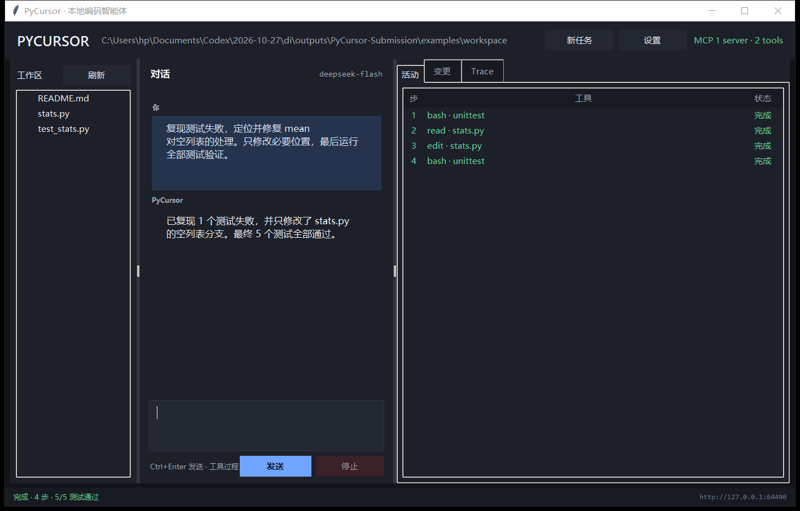
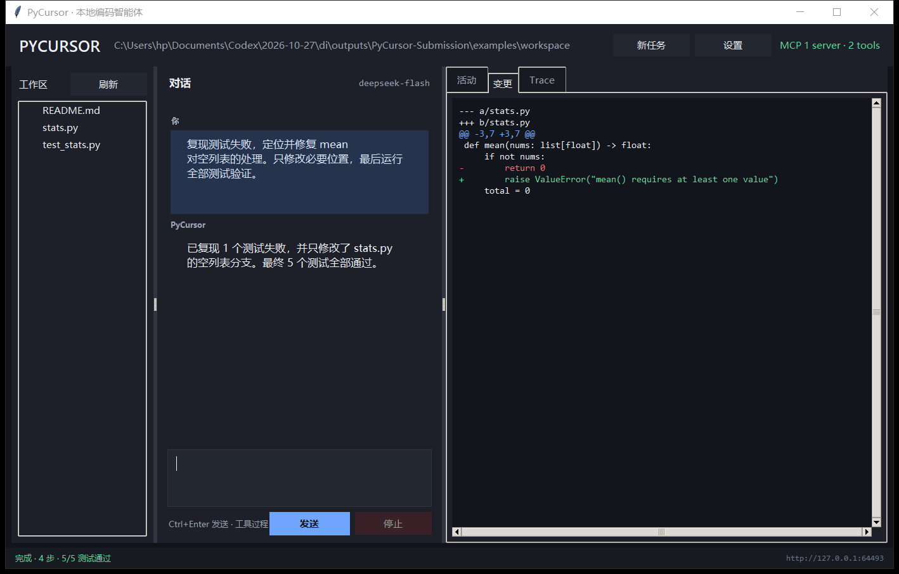
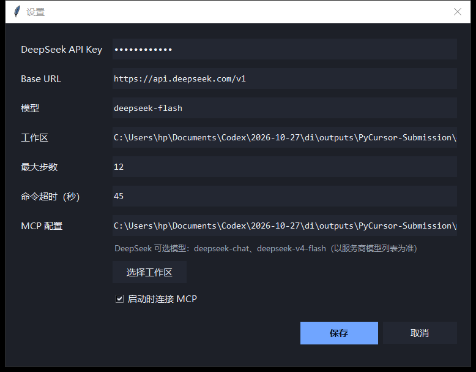
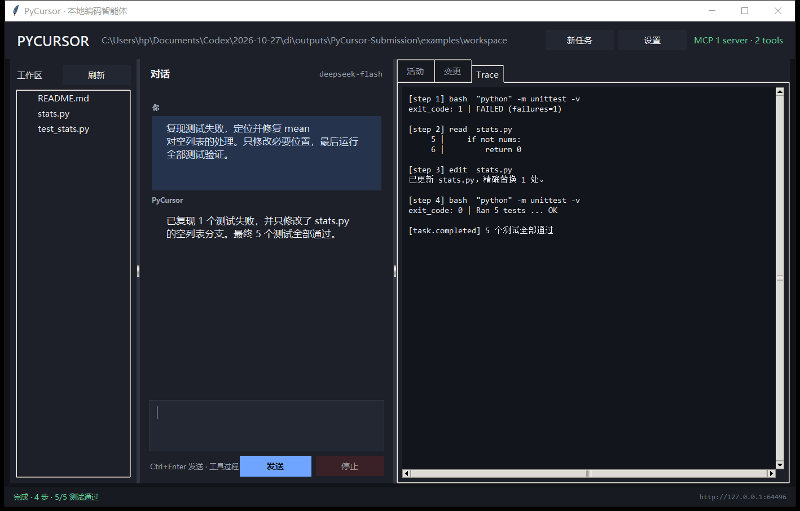

# PyCursor

一个可双击打开的本地桌面编码智能体。后端负责模型循环、四个编码工具、MCP
连接和事件流；Tkinter 前端只负责展示对话、文件、工具活动与 diff。

实现对应课程第 35 页大作业及第 36–39 页验收要求。

## 换一台电脑后，三步启动

1. 下载并双击 `PyCursor-Setup-1.0.0.exe`，安装完成后打开 PyCursor。
2. 点击右上角“设置”，填写 DeepSeek API Key，Base URL 保持
   `https://api.deepseek.com/v1`，模型填写 `deepseek-chat` 或账户支持的
   `deepseek-v4-flash`。
3. 点击“选择工作区”，选中代码目录，在底部输入任务并按 `Ctrl+Enter`。

安装版自带 Python、Tk 和 MCP 运行环境，目标电脑不需要预装 Python。

## 界面







完整 Trace 视图：



## 演示视频

[播放实时操作演示](demo.mp4)

视频由应用自身逐帧录制：DeepSeek 模型真实返回工具调用，read/edit/bash、MCP 与测试
均为实际执行结果。演示任务从测试失败开始，最终 5/5 通过。

## 功能

- 真桌面窗口，不依赖浏览器或 localhost 页面。
- 默认接入 DeepSeek 官方 API，使用 `deepseek-chat` 和标准 function calling。
- 只有四个内置工具：`read`、`write`、`edit`、`bash`。
- 每次工具调用的参数、结果、错误和 diff 都进入可见 trace。
- `bash` 支持超时、输出截断和“停止”中断；Windows 下会终止整个进程树。
- `read` 对文本分页并带行号，对图片返回 base64 多模态内容块。
- `edit` 只接受唯一精确匹配；零次或多次命中都会拒绝。
- `write` 自动创建父目录并使用临时文件 + rename 原子写入。
- 标准 MCP stdio 客户端，可发现并调用独立 server 的工具。
- 后端可独立启动，`curl -N` 能直接观察事件流。
- 会话保存在本机状态目录，多轮对话不依赖前端内存。

## 直接安装（推荐）

双击 `dist\PyCursor-Setup-1.0.0.exe`。安装器会安装到当前用户目录、创建快捷方式并
启动窗口。默认模型为 DeepSeek `deepseek-chat`，进入右上角“设置”填写
DeepSeek API Key 后即可使用。

安装版不要求用户预装 Python。该本地构建未做代码签名，Windows SmartScreen 可能
显示“未知发布者”。

## 从源码启动

要求 Windows 10/11 和 Python 3.10+（含 Tkinter）。运行时没有第三方 Python 依赖。

1. 在项目目录打开 PowerShell，创建本地配置：

   ```powershell
   Copy-Item .env.example .env
   ```

2. 编辑 `.env`，至少填写：

   ```text
   PYCURSOR_API_KEY=你的 DeepSeek 密钥
   PYCURSOR_MODEL=deepseek-chat
   PYCURSOR_BASE_URL=https://api.deepseek.com/v1
   ```

3. 双击 `PyCursor.cmd`。也可以在 PowerShell 中运行：

   ```powershell
   python -m pycursor --workspace .\examples\workspace
   ```

首次运行后也可以从窗口右上角“设置”修改 Key、模型、工作区、最大步数和 MCP
配置。真实 Key 只保存在本机状态目录，不应写入仓库。

### DeepSeek 默认配置

| 设置 | 默认值 |
| --- | --- |
| Base URL | `https://api.deepseek.com/v1` |
| 模型 | `deepseek-chat` |
| API Key | `DEEPSEEK_API_KEY` 或 `PYCURSOR_API_KEY` |

`deepseek-chat` 支持 PyCursor 所需的工具调用。程序仍允许在“设置”中替换成其他
兼容 Chat Completions 的服务，但课程演示的默认路径不依赖 GPT 模型。

如果 DeepSeek 服务商明确提供 `deepseek-v4-flash`，可以在“模型”一栏直接填入：

```text
deepseek-v4-flash
```

PyCursor 不写死模型列表，只要该接口实现 `/chat/completions`、使用 Bearer Key
并支持 function calling 就能工作。模型名称是否可用最终以服务商文档和账户的模型
列表为准。

## 演示任务

示例工作区的 `stats.py` 故意让 `mean([])` 返回 `0`，而测试要求抛出
`ValueError`。打开示例工作区后输入：

```text
复现测试失败，定位并修复 mean 对空列表的处理。只修改必要位置，最后运行全部测试。
```

预期行为：

1. 运行测试并看到 1 个失败。
2. 读取 `stats.py`。
3. 用唯一匹配把 `return 0` 改为 `raise ValueError(...)`。
4. diff 面板显示变更。
5. 再运行测试，5/5 通过。

不需要 API Key 也能验证核心链路：

```powershell
python scripts\replay_demo.py
```

它会真实执行 read/edit/bash，并把 trace 写入 `docs/trace.md`。

## 后端与事件流

后端可以脱离桌面界面运行：

```powershell
python -m pycursor.server --host 127.0.0.1 --port 8765 --workspace .\examples\workspace
```

创建任务：

```powershell
curl.exe -X POST http://127.0.0.1:8765/api/tasks `
  -H "Content-Type: application/json" `
  -d "{\"prompt\":\"运行测试并说明失败原因\"}"
```

响应会给出 `task_id`。随后持续观察事件流：

```powershell
curl.exe -N http://127.0.0.1:8765/api/tasks/<task_id>/events
```

事件类型包括 `model.*`、`tool.*`、`change.diff`、`context.compacted`、
`task.completed`、`task.cancelled` 和 `task.failed`。

也可按 `Ctrl+C` 停止 `curl`，任务不会因为客户端断开而终止。停止任务需要：

```powershell
curl.exe -X POST http://127.0.0.1:8765/api/tasks/<task_id>/cancel
```

## 四个工具

| 工具 | 语义 | 关键护栏 |
| --- | --- | --- |
| `read` | 按行读取 UTF-8 文本；图片返回多模态内容 | 工作区路径校验、分页、文件与图片大小上限 |
| `write` | 创建或替换文件 | 创建父目录、原子写、报告修改前后行数 |
| `edit` | 精确字符串替换 | `old` 必须唯一；零次或多次命中直接失败 |
| `bash` | 在工作区运行命令 | 超时、输出上限、非零退出码正常回灌、可中断 |

模型只提出调用意图。真正执行权在 `pycursor/tools.py` 的白名单路由中。

## MCP

默认 `mcp.json` 启动仓库内的独立 stdio server：

```json
{
  "servers": {
    "demo": {
      "command": "${PYTHON_OR_APP}",
      "args": ["mcp_servers/demo_server.py"],
      "cwd": ".",
      "enabled": true
    }
  }
}
```

实现对 `initialize`、`notifications/initialized`、`tools/list`（含 cursor
分页）和 `tools/call` 做 JSON-RPC 往返。MCP 工具以
`mcp__<server>__<tool>` 注入模型，界面会显示 server 与工具数量。

验证 MCP：

```text
调用 get_system_info，并说明这是通过 MCP 得到的当前进程信息。
```

安装第三方 MCP server 前应检查源码和权限，并只开放完成工作所需的最小能力。

## 测试

```powershell
python -m unittest discover -s tests -v
```

测试覆盖路径越界、分页读取、多模态图片、原子写、edit 非唯一失败、非零退出码、
命令超时、输出截断、智能体循环、取消、步数上限、MCP 调用和 HTTP 健康检查。

## 打包

构建 Windows 桌面程序：

```powershell
.\scripts\build_windows.ps1
```

脚本会创建隔离构建环境并安装 PyInstaller。Windows 目录构建位于
`dist\PyCursor\PyCursor.exe`，可直接双击；分发压缩包位于
`dist\PyCursor-Windows-x64.zip`。

安装器构建：

```powershell
.\scripts\build_sfx_setup.ps1
```

该脚本使用 WinRAR 自解压模块生成 `dist\PyCursor-Setup-1.0.0.exe`，安装到当前用户的
`%LOCALAPPDATA%\Programs\PyCursor` 并创建桌面与开始菜单快捷方式。构建机需要 WinRAR；
安装后的用户不需要 WinRAR、Python 或其他运行时。`scripts\installer.iss` 保留为
Inno Setup 6 的可选替代方案。

仅生成无需编译的便携压缩包：

```powershell
.\scripts\package_portable.ps1
```

打包后的 MCP 内置示例通过同一个可执行文件的 `--mcp-demo` 子模式启动。

## 安全边界

`bash` 本质上拥有启动它的用户权限。应用把 read/write/edit 限制在所选工作区，
并限制命令超时与输出，但无法在普通桌面进程中提供操作系统级沙箱。处理不可信
仓库时，应在受限容器或低权限用户下运行，并审查第三方 MCP server。

